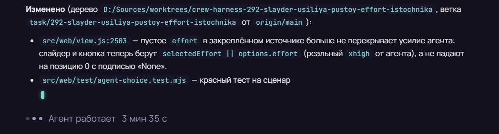

# Задание: Курсор не там, где появляется текст (веб-вид)

Дата: 2026-11-13 12:08

В веб-виде (src/web/view.js) блочный курсор рисуется не там, где дописывается поток текста: на скриншоте владельца курсор стоит после второго пункта списка, хотя текст сообщения продолжает приходить ниже. Найти, где вычисляется позиция курсора при потоковой отрисовке, исправить, проверить на стримящемся сообщении со списком.

## Сообщение владельца

курсор стоит не в том месте, где появляется текст

