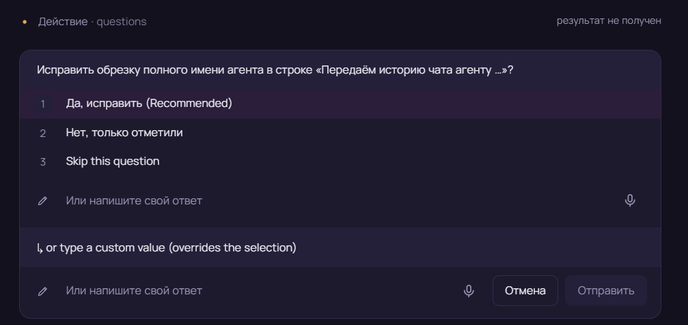
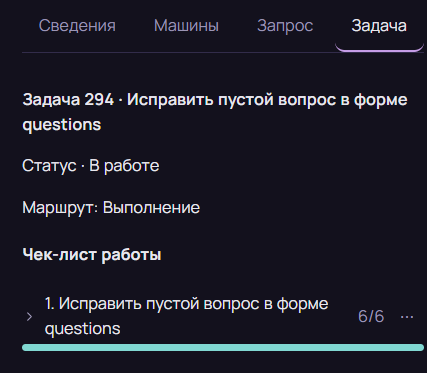
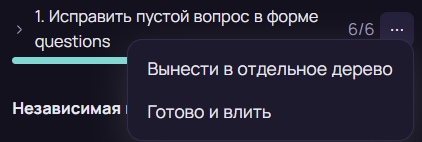

# Задание: Исправить пустой вопрос в форме questions

Дата: 2026-11-13 17:07

В форме вопросов (ask_user_question / UI src/web) второй вопрос отрисовался без текста и вариантов — только поле свободного ввода. Найти, кто формирует такой пустой вопрос (агент/плагин или веб-UI), добавить валидацию: запись без question/options отбраковывается, а не показывается пустой карточкой. Покрыть тестом.

## Сообщение владельца

что это за вопрос такой с просьбой вести текст? ввести текст и так можно в любом вопросе, это ошибка?

---

вот вопрос 1 из той же формы, там есть возможность ввести свой текст, зачем вопрос 2 по факты без вопроса?

## Дополнение 2026-11-13 17:14

Внизу чата подпись «Маршрут: Малый путь», а в карточке задачи справа — «Маршрут: Выполнение» для одной и той же сессии. Привести подписи к единому виду: обе метки должны брать одно локализованное имя маршрута, покрыть тестом.

> что это за вопрос такой с просьбой вести текст? ввести текст и так можно в любом вопросе, это ошибка?
> 
> ---
> 
> вот вопрос 1 из той же формы, там есть возможность ввести свой текст, зачем вопрос 2 по факты без вопроса?
> 
> ---
> 
> внизу указан малый путь, справа маршрут выполнение

