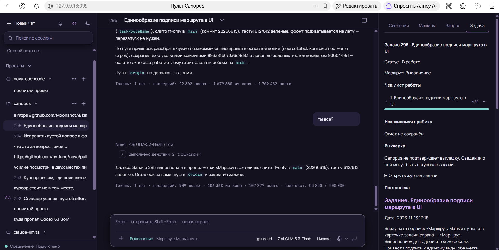
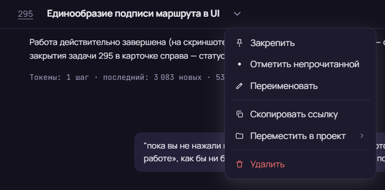
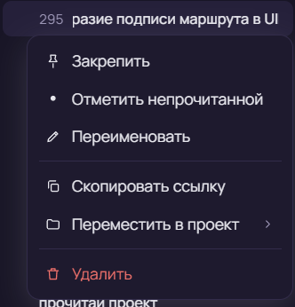
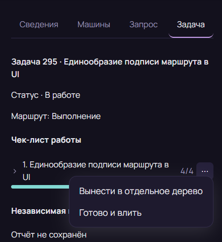

# Задание: Единообразие подписи маршрута в UI

## Чего хочет владелец

Дата: 2026-11-13 17:18

Вижу несостыковку: внизу чата подпись «Маршрут: Малый путь», а в карточке задачи справа — «Маршрут: Выполнение». Это одно и то же по смыслу («Выполнение» — режим, «малый маршрут/путь» — его путь методики), но надписи разные: похоже, две метки берутся из разных мест (локализованное имя маршрута сессии vs имя режима задачи) и не сверяются. Это ошибка отображения, не две разные сущности.

Заодно агент задачи 294 уже нашёл вероятную причину пустого вопроса (displayQuestions в lists.js:188 возвращает пустой текст при неудачном восстановлении).

Завести отдельную задачу на единообразие надписи маршрута («Выполнение» ↔ «Малый путь»)? - да

### Дополнение 2026-11-14 01:13

Владелец не может закрыть задачу из UI: «Готово и влить» закрывает только подзадачу (route_subtask_done), а статус самой задачи («В работе») меняется лишь автоматически по завершении маршрута. Нужна видимая кнопка владельца «Закрыть задачу» (сервер уже поддерживает op «close» и state «done» в rt_task_op) в панели «Задача» рядом со строкой «Статус: …». Покрыть тестом.

> нажал «Готово и влить» - ничего не произошло

## Что нужно

Внизу чата подпись «Маршрут: Малый путь», а в карточке задачи справа — «Маршрут: Выполнение» для одной и той же сессии. Привести подписи к единому виду: обе метки должны брать одно локализованное имя маршрута, покрыть тестом.

## Критерии приёмки

Обе подписи показывают одно локализованное имя маршрута. Владелец может закрыть задачу из её панели. Оба случая покрыты тестами.

## Результат и куда он попадает

Изменения веб-интерфейса и регрессионные тесты.

## Связи

Сценарий обнаружен при проверке [задачи 294](../../294-ispravit-pustoy-vopros-v-forme-questions/task/message.md).

## Границы

Подписи маршрута и закрытие задачи владельцем из панели.
